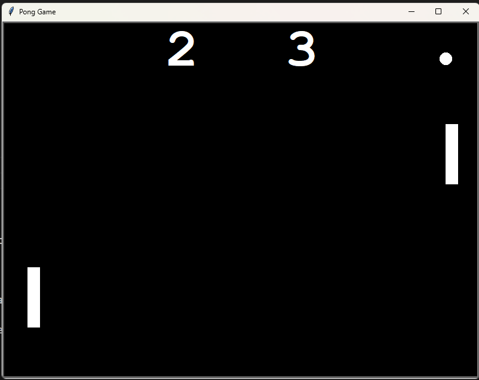

# Pong Game 🏓

A simple Pong game built using Python's Turtle module as part of the **100 Days of Code** course by Dr. Angela Yu.

## 🎮 How to Play

- **Player 1 (Left Paddle):** Move up with `W`, move down with `S`
- **Player 2 (Right Paddle):** Move up with `Up Arrow`, move down with `Down Arrow`
- The ball bounces off the walls and paddles.
- If a player misses the ball, the opponent scores a point.

## 🛠️ Setup

1. Clone this repository:
   ```sh
   git clone https://github.com/mevaser/pong-game.git
   ```
2. Navigate into the project folder:
   ```sh
   cd pong-game
   ```
3. Check your Python 3 installation has Tk: run `python -m tkinter`. A small test window should open; close it. On systems where Tk is packaged separately, install the Tk package for that Python installation. No pip dependencies are required.
4. Run `python main.py` from this directory on a desktop with a display.

**Try a short rally:** release W/S and Up/Down to move the left and right paddles. Meet the ball with a paddle to speed it up; let it pass to give the opponent one point. Each new serve returns to the initial speed. Press Escape or close the window to end the match. A fresh launch starts at 0–0.

To repeat the desktop checks (a Tk display is required), run `python smoke_tk.py`. It uses the real screen and Turtle objects to check keyboard controls, rebounds, both scoring boundaries, a new rally, and both exit paths.

## 🚀 Features

- Simple and fun gameplay
- Speed increases with each paddle hit
- Score tracking

## 📷 Screenshot



## 📜 License

This project is open-source. Feel free to modify and improve it! 🚀
